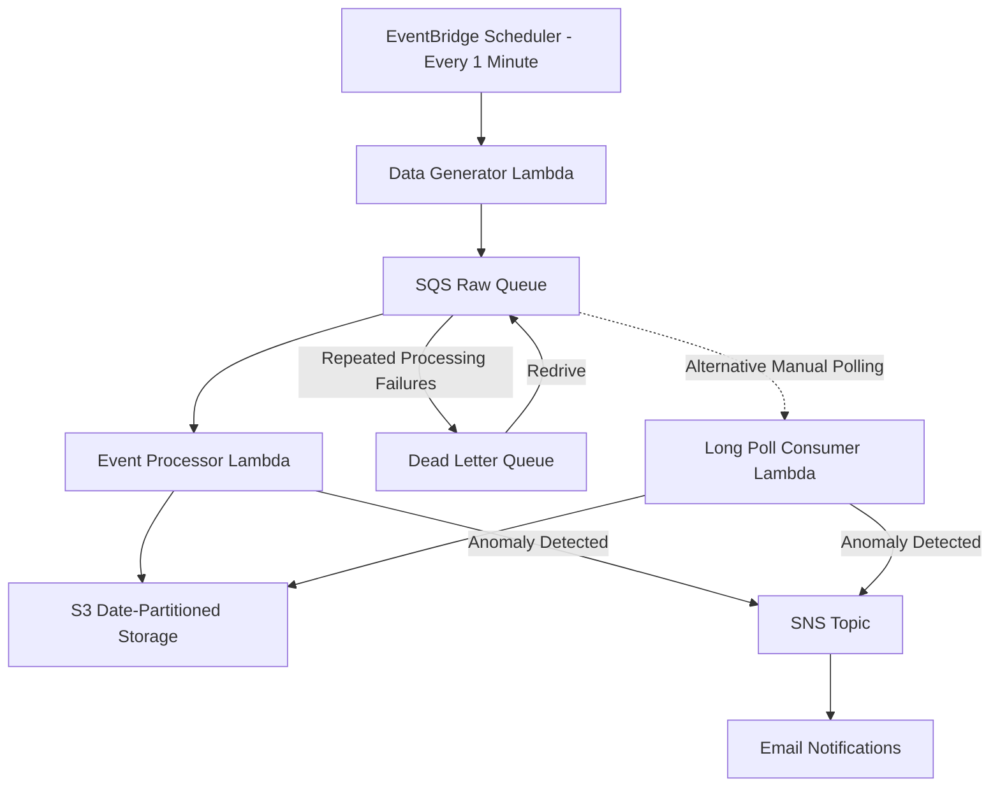
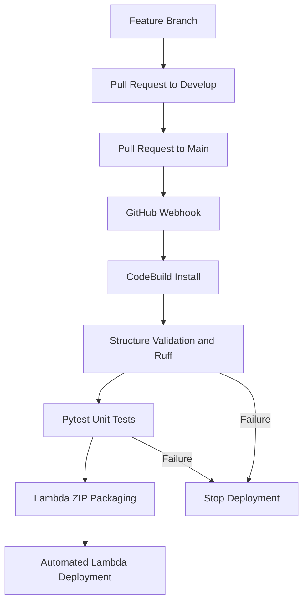

# ColdChain Monitoring Pipeline

## 1. Project Overview

The ColdChain Monitoring Pipeline is a serverless, event-driven AWS data engineering solution designed to simulate real-time IoT sensor monitoring across temperature-controlled warehouses.

The pipeline generates mock sensor readings, ingests data through Amazon SQS, detects anomalies using AWS Lambda, sends email alerts through Amazon SNS, and stores processed sensor readings in Amazon S3.

The project also demonstrates alternative SQS consumption patterns, dead-letter queue handling, automated unit testing, and CI/CD deployment using GitHub and AWS CodeBuild.

## 2. Project Objectives

- Simulate real-time IoT sensor data.
- Implement asynchronous message ingestion using Amazon SQS.
- Detect temperature, humidity, and battery anomalies.
- Deliver automated email notifications using Amazon SNS.
- Store processed sensor readings in date-partitioned S3 storage.
- Implement event-driven and long-polling consumer patterns.
- Demonstrate failure handling and DLQ redrive.
- Automate Lambda deployment using GitHub and AWS CodeBuild.

## 3. Technologies Used

| Technology | Purpose |
|---|---|
| Python 3.13 | Lambda functions and processing logic |
| Boto3 | AWS service integration |
| AWS Lambda | Serverless data generation and processing |
| Amazon SQS | Asynchronous message ingestion |
| Amazon SNS | Anomaly alert notifications |
| Amazon EventBridge Scheduler | Scheduled data generation |
| Amazon S3 | Processed data storage |
| AWS IAM | Access control and permissions |
| Amazon CloudWatch | Logging and monitoring |
| AWS Secrets Manager | GitHub authentication credential management |
| AWS CodeBuild | Automated testing, packaging and deployment |
| Git and GitHub | Version control and branching |
| Pytest | Unit testing |
| Ruff | Python linting |
| AWS CLI | Resource verification and deployment |

## 4. End-to-End Architecture



### Data Flow

1. EventBridge Scheduler invokes the data generator Lambda every minute when enabled.
2. The generator produces 35 mock sensor readings per invocation.
3. Each reading is published as an individual SQS message.
4. The event-driven consumer automatically processes messages when its event source mapping is enabled.
5. Sensor readings are validated and checked for anomalies.
6. Processed readings are stored in S3 in JSON Lines format.
7. Anomaly notifications are published to SNS.
8. Messages that repeatedly fail processing are transferred to the DLQ.
9. Failed messages can be redriven to the source queue for reprocessing.

## 5. Mock Sensor Dataset

The project generates synthetic IoT data without requiring an external dataset.

### Sample Sensor Reading

```json
{
    "sensor_id": "SENS-WH01-T003",
    "warehouse_id": "WH-01",
    "zone": "cold-storage-A",
    "reading_type": "temperature",
    "value": -18.5,
    "unit": "celsius",
    "timestamp": "2026-11-24T10:30:00Z",
    "battery_pct": 82
}
```

### Warehouses

- WH-01
- WH-02
- WH-03

### Warehouse Zones

- cold-storage-A
- cold-storage-B
- dry-storage
- loading-dock

### Sensor Simulation and Anomaly Rules

| Reading | Normal Range | Simulation Rule |
|---|---|---|
| Cold storage temperature | -25°C to -15°C | 15% anomaly probability |
| Dry storage temperature | 15°C to 25°C | 15% anomaly probability |
| Loading dock temperature | 15°C to 25°C | 15% anomaly probability |
| Humidity | 30% to 60% | 10% anomaly probability |
| Battery | 15% and above | Alert when below 15% |

Battery percentages are generated between 5 and 100.

The generator uses Python's random and datetime modules and returns a publishing summary grouped by warehouse and zone.

## 6. AWS Resource Configuration

AWS Region: Asia Pacific (Hyderabad) — ap-south-2

| Resource | Name |
|---|---|
| SQS source queue | coldchain-sensor-raw-queue |
| SQS dead-letter queue | coldchain-sensor-dlq |
| SNS topic | coldchain-warehouse-alerts |
| Generator Lambda | coldchain_data_generator |
| Event processor Lambda | coldchain_event_processor |
| Long-poll consumer Lambda | coldchain_long_poll_consumer |
| EventBridge schedule | coldchain-sensor-generator-schedule |
| S3 bucket | coldchain-sensor-readings-n112026 |
| CodeBuild project | coldchain-pipeline-build |

## 7. SQS Queue Setup

A Standard SQS queue is used because strict message ordering is not required for independent IoT sensor readings.

### Source Queue Configuration

| Parameter | Value | Reason |
|---|---|---|
| Queue type | Standard | Supports scalable asynchronous ingestion |
| Visibility timeout | 60 seconds | Provides time for message processing before retry |
| Message retention | 4 days | Retains unprocessed messages during temporary failures |
| Maximum message size | 256 KB | Sufficient for lightweight JSON sensor readings |
| Delivery delay | 0 seconds | Supports immediate processing |
| Receive message wait time | 10 seconds | Reduces unnecessary polling requests |
| Maximum receive count | 3 | Limits repeated processing failures |

### Dead Letter Queue Configuration

- Queue type: Standard
- Message retention: 14 days
- Associated with the source queue through a redrive policy.
- Maximum receive count: 3

The longer DLQ retention period provides additional time to investigate failed messages and perform recovery.

## 8. SNS Topic and Email Subscription

A Standard SNS topic is used for anomaly notifications.

Standard SNS was selected because strict notification ordering is not required, and email subscriptions are supported.

Setup:

1. Create the Standard SNS topic.
2. Configure an email subscription.
3. Confirm the subscription through the confirmation email.
4. Publish a manual test notification.
5. Verify email delivery.
6. Configure the consumer Lambda functions with the SNS topic ARN.

Anomaly notifications include sensor identification, warehouse, zone, reading type, actual value, expected range, and timestamp.

Both manual SNS notifications and automated anomaly alerts were verified.

## 9. Lambda Function Implementation

### 9.1 Data Generator Lambda

Responsibilities:

- Generate 35 synthetic sensor readings per invocation.
- Randomly select warehouses and warehouse zones.
- Simulate temperature and humidity anomalies.
- Generate battery percentages and UTC timestamps.
- Publish individual JSON messages to SQS.
- Return a publishing summary.

### 9.2 Event-Driven Consumer Lambda

Responsibilities:

- Automatically consume SQS messages through an event source mapping.
- Parse and validate incoming JSON messages.
- Detect temperature, humidity, and low-battery anomalies.
- Publish customized SNS alerts.
- Store processed readings in S3.
- Report individual failed messages using partial batch failure handling.

Event source mapping configuration:

- Batch size: 5
- Batch window: 0 seconds
- Partial batch failure reporting: Enabled

Partial batch failure reporting allows failed messages to be retried without unnecessarily retrying successfully processed messages from the same batch.

### 9.3 Long-Poll Consumer Lambda

An alternative consumer was implemented to demonstrate programmatic SQS polling.

Responsibilities:

- Retrieve messages using boto3 receive_message().
- Use WaitTimeSeconds=10.
- Retrieve up to five messages per request.
- Process sensor readings using shared processing logic.
- Delete messages only after successful processing.
- Log processing results and failures.
- Handle empty queue responses.

This Lambda is invoked manually and does not have an SQS event source mapping.

The event-driven consumer was disabled during long-polling demonstrations to avoid competing consumers.

### 9.4 Shared Processing Module

Common processing logic is maintained in:

`lambdas/common/sensor_processor.py`

The shared module handles:

- Sensor data validation.
- Anomaly detection.
- SNS notification publishing.
- S3 storage.

This design reduces code duplication and ensures consistent processing behavior across both consumer implementations.

## 10. EventBridge Scheduler

The EventBridge schedule is configured with:

```
rate(1 minute)
```

Setup:

1. Create an EventBridge schedule.
2. Configure a recurring one-minute rate expression.
3. Select the data generator Lambda as the target.
4. Configure an execution role with Lambda invocation permission.
5. Enable the schedule during testing.
6. Verify scheduled invocations through CloudWatch logs.

Consecutive scheduled Lambda invocations were verified.

The scheduler is disabled when the project is not being tested to avoid unnecessary resource usage.

## 11. S3 Data Storage

All successfully processed sensor readings are stored in Amazon S3, including normal and anomalous readings.

Data is stored in JSON Lines format using date-based partitioning.

```
s3://coldchain-sensor-readings-n112026/
    YYYY/
        MM/
            DD/
                readings_<timestamp>_<message_id>.jsonl
```

Date partitioning provides:

- Organized historical storage.
- Efficient date-based data retrieval.
- Support for future analytics using services such as Amazon Athena.
- Easier data lifecycle management.

Message identifiers are included in object naming to reduce accidental overwrites between different readings.

## 12. IAM Roles and Permissions

Separate IAM roles were used to follow the principle of least privilege.

| Component | Required Permissions |
|---|---|
| Data generator Lambda | SQS SendMessage and CloudWatch logging |
| Event processor Lambda | SQS ReceiveMessage, DeleteMessage, GetQueueAttributes, SNS Publish, S3 PutObject and CloudWatch logging |
| Long-poll consumer Lambda | SQS ReceiveMessage, DeleteMessage, GetQueueAttributes, SNS Publish, S3 PutObject and CloudWatch logging |
| EventBridge Scheduler | Lambda InvokeFunction |
| CodeBuild | Lambda UpdateFunctionCode, GetFunctionConfiguration, UpdateFunctionConfiguration for the event processor, Secrets Manager access and CloudWatch logging |

Resource-specific permissions were configured where applicable.

GitHub authentication credentials are managed through AWS Secrets Manager and are not committed to the repository.

## 13. Dead Letter Queue and Redrive Demonstration

Failure handling was demonstrated using intentionally malformed sensor messages containing missing required fields.

### Recovery Workflow

1. Publish an invalid sensor message to the source queue.
2. Allow the consumer to attempt processing.
3. Verify validation failure in CloudWatch logs.
4. Allow repeated processing failures to transfer the message to the DLQ.
5. Inspect the failed message in the DLQ.
6. Initiate an SQS redrive task.
7. Apply a temporary recovery rule for the selected synthetic test message.
8. Verify successful reprocessing and message deletion.
9. Verify the recovered sensor reading in S3.
10. Remove the temporary recovery rule from the final source code.

The successful redrive demonstration used the long-poll consumer and a controlled missing-field recovery scenario. This differs from the assignment's suggested event-driven warehouse-specific intentional error simulation.

An earlier event-driven validation failure also demonstrated transfer of a malformed message to the DLQ.

The temporary recovery logic was removed so that the final implementation continues to enforce required-field validation.

## 14. Repository Structure

```
coldchain-monitoring-pipeline/
├── lambdas/
│   ├── common/
│   │   └── sensor_processor.py
│   ├── data_generator/
│   │   └── lambda_function.py
│   ├── event_processor/
│   │   ├── lambda_function.py
│   │   └── requirements.txt
│   └── long_poll_consumer/
│       └── lambda_function.py
├── config/
│   ├── sqs-redrive-policy.json
│   └── codebuild-webhook-filters.json
├── scripts/
│   ├── package_lambdas.py
│   └── deploy.sh
├── tests/
│   ├── conftest.py
│   ├── test_event_processor_local.py
│   ├── test_long_poll_consumer.py
│   └── test_sensor_processor.py
├── screenshots/
├── .env.example
├── .gitignore
├── requirements.txt
├── buildspec.yml
└── README.md
```

The tree highlights the primary implementation and configuration files.

## 15. Local Development and Testing

### Clone the Repository

```bash
git clone https://github.com/SanthiVarma-24/coldchain-monitoring-pipeline.git
cd coldchain-monitoring-pipeline
```

### Create a Virtual Environment

```powershell
python -m venv .venv
.\.venv\Scripts\Activate.ps1
```

### Install Dependencies

```bash
python -m pip install -r requirements.txt
```

### Configure Environment Variables

Copy `.env.example` to `.env` for local development and configure the appropriate AWS resource values.

| Variable | Purpose |
|---|---|
| AWS_REGION | AWS resource region |
| SQS_QUEUE_URL | Source queue URL |
| SQS_QUEUE_ARN | Source queue ARN |
| SNS_TOPIC_ARN | Alert topic ARN |
| S3_BUCKET_NAME | Processed data bucket |
| LOG_LEVEL | Application logging level |

AWS credentials should be configured securely through the AWS CLI or an appropriate credential provider.

The `.env` file, virtual environment, generated ZIP files, and local cache files are excluded from version control.

### Run Lint Checks

```bash
python -m ruff check lambdas/ scripts/ tests/
```

### Run Unit Tests

```bash
python -m pytest tests/ -v
```

Test coverage includes:

- Sensor validation.
- Anomaly detection.
- Successful event processing.
- S3 upload failure handling.
- SNS publishing failure handling.
- Partial batch failures.
- Invalid JSON handling.
- Missing required fields.
- Long-poll message processing.
- Message deletion and failure handling.
- Empty queue behavior.

Final local test result: **19 tests passed.**

The shared pytest configuration supplies dummy AWS resource values and credentials so that unit tests do not depend on the local `.env` file.

## 16. Manual Deployment — Initial Setup

The initial AWS infrastructure and Lambda functions were created manually before implementing automated deployment.

### Deployment Steps

1. Create the SQS source queue and DLQ.
2. Configure the source queue redrive policy.
3. Create the SNS topic and confirm the email subscription.
4. Create an S3 bucket for processed readings.
5. Create IAM execution roles with the required permissions.
6. Create the three Lambda functions using Python 3.13.
7. Configure the required Lambda environment variables.
8. Generate the Lambda deployment packages.
9. Upload the corresponding ZIP package to each Lambda function.
10. Configure the Lambda handlers.
11. Configure the SQS event source mapping for the event processor.
12. Create the EventBridge schedule targeting the data generator.
13. Test each component independently.

### Generate Deployment Packages

```bash
python scripts/package_lambdas.py
```

The packaging script creates:

```
build/coldchain_data_generator.zip
build/coldchain_event_processor.zip
build/coldchain_long_poll_consumer.zip
```

### Lambda Handler Configuration

| Lambda | Handler |
|---|---|
| Data generator | lambda_function.lambda_handler |
| Event processor | lambdas.event_processor.lambda_function.lambda_handler |
| Long-poll consumer | lambdas.long_poll_consumer.lambda_function.lambda_handler |

The consumer deployment packages include the shared sensor processing module.

## 17. GitHub Branching Strategy

The repository follows a structured branching workflow.

| Branch | Purpose |
|---|---|
| main | Production-ready code |
| develop | Integration branch |
| feature/codebuild-cicd | CI/CD implementation and corrections |

Changes are integrated through GitHub pull requests.

```
feature/codebuild-cicd
          |
          v
       develop
          |
          v
         main
          |
          v
     AWS CodeBuild
```

Feature and integration branch changes do not trigger automated deployment.

Only pushes to the main branch trigger CodeBuild.

## 18. Automated CI/CD Deployment

AWS CodeBuild automates validation, testing, packaging, and deployment of all three Lambda functions.

### CI/CD Architecture



### CodeBuild Configuration

| Parameter | Configuration |
|---|---|
| Project name | coldchain-pipeline-build |
| Source provider | GitHub |
| Deployment branch | main |
| Environment | Managed Ubuntu Standard 7.0 |
| Runtime | Python 3.13 |
| Build specification | buildspec.yml |
| Logging | Amazon CloudWatch |
| Authentication | GitHub token through AWS Secrets Manager |

### Webhook Configuration

The webhook uses the following filters in the same filter group:

```
EVENT: PUSH
HEAD_REF: ^refs/heads/main$
```

This ensures that automated builds are triggered only by pushes to main.

### Build Phases

| Phase | Responsibility |
|---|---|
| INSTALL | Install project dependencies |
| PRE_BUILD | Validate repository structure, lint Python files and execute unit tests |
| BUILD | Generate Lambda ZIP deployment packages |
| POST_BUILD | Deploy all three Lambda functions using AWS CLI |

The deployment script uses AWS Lambda update-function-code commands and waits for function updates to complete.

A deployment safeguard prevents deployment when an earlier build phase fails.

### CI/CD Verification Results

| Scenario | Result |
|---|---|
| Push to feature branch | No build triggered |
| Merge feature into develop | No build triggered |
| Merge develop into main | Build triggered automatically |
| Corrected cloud build | Succeeded |
| Automated deployment of three Lambda functions | Successful |
| Lambda update status verification | Successful |

## 19. Troubleshooting and Resolution

### CodeBuild GitHub Webhook Authentication

The initial webhook creation encountered a GitHub permission issue.

Resolution:

- Updated the existing fine-grained GitHub token to include the ColdChain repository.
- Configured CodeBuild authentication through AWS Secrets Manager.
- Created and verified the main-branch webhook filters using AWS CLI.

### CodeBuild Unit Test Failure

The first automated build failed during PRE_BUILD because the event processor tests depended on an environment variable unavailable in the CodeBuild environment.

Error:

```
ValueError: SNS_TOPIC_ARN environment variable is missing
```

Resolution:

- Created a shared pytest configuration in tests/conftest.py.
- Configured dummy AWS credentials and resource environment variables.
- Removed the local dotenv dependency from the affected test module.
- Revalidated all 19 unit tests.
- Committed the correction to the feature branch.
- Merged the correction through develop into main.

The subsequent CodeBuild execution succeeded, and all three Lambda functions were successfully updated.

## 20. Testing and Screenshot Evidence

Project implementation evidence is available in the [screenshots](screenshots/) directory.

| Evidence | Demonstration |
|---|---|
| SNS subscription confirmation | Successful email subscription |
| SNS test email | Manual notification delivery |
| EventBridge schedule configuration | One-minute scheduling |
| Scheduled Lambda invocation logs | Consecutive scheduled invocations |
| Event-driven consumer logs | Automatic SQS message processing |
| Automated SNS anomaly alert | Anomaly notification delivery |
| S3 storage | Date-partitioned processed readings |
| Long-poll consumer logs | Manual message consumption and deletion |
| Long-poll failure logs | Failed message processing |
| DLQ message evidence | Failed message transferred to DLQ |
| DLQ redrive evidence | Message returned to source queue |
| Successful reprocessing | Recovery of failed sensor reading |
| Recovered S3 output | Successfully stored recovered reading |
| CodeBuild feature branch verification | No automatic build from feature branch |
| CodeBuild build history | Failed build followed by successful automated build |

## 21. Assumptions and Design Decisions

- Synthetic sensor data is used for demonstration purposes.
- Independent sensor readings do not require strict message ordering.
- Standard SQS provides at-least-once delivery, so duplicate delivery is possible.
- Both consumer patterns share common processing logic.
- The event-driven consumer is the intended final automated processing pattern.
- The long-poll consumer is retained for manual demonstrations.
- The two consumers are not intentionally operated concurrently.
- AWS resource identifiers are supplied through environment variables.
- Sensitive credentials are excluded from GitHub.
- Lambda runtime-provided boto3 is used for AWS integration.
- Temporary recovery logic is restricted to the controlled DLQ demonstration and removed from the final implementation.
- The scheduler is disabled outside testing to control resource usage.

## 22. Validation Scope and Limitations

- Scheduled invocations were demonstrated, but the full ten-minute queue accumulation evidence has not been independently confirmed.
- DLQ redrive and successful recovery were demonstrated through the long-poll consumer rather than the exact warehouse-specific event-driven failure scenario.
- Automated deployment and Lambda update statuses were verified. An additional end-to-end smoke test after the final automated deployment was not performed.
- The project demonstrates a learning-oriented serverless architecture rather than a fully production-hardened monitoring platform.

## 23. Future Enhancements

- Implement comprehensive idempotency and duplicate message handling.
- Configure CloudWatch alarms for queue depth and DLQ message counts.
- Introduce infrastructure as code using AWS CloudFormation or Terraform.
- Implement S3 lifecycle policies.
- Enable analytical querying through Amazon Athena.
- Build warehouse monitoring dashboards.
- Introduce deployment versioning and rollback strategies.

## 24. Conclusion

The ColdChain Monitoring Pipeline demonstrates the implementation of a serverless IoT data ingestion and anomaly detection solution using AWS services.

The project integrates asynchronous messaging, scheduled data generation, event-driven processing, long polling, anomaly notifications, date-partitioned storage, failure recovery, unit testing, and automated CI/CD deployment.

The successful CodeBuild deployment demonstrates a structured development workflow from source code changes through automated testing, packaging, and Lambda deployment.